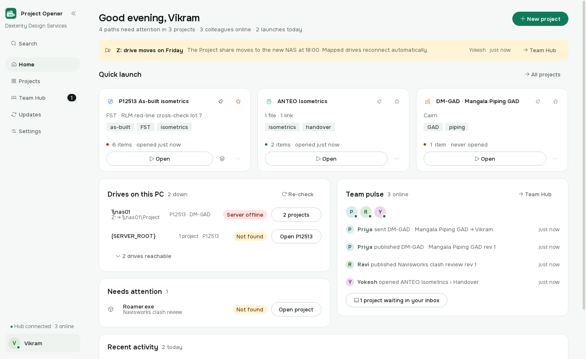
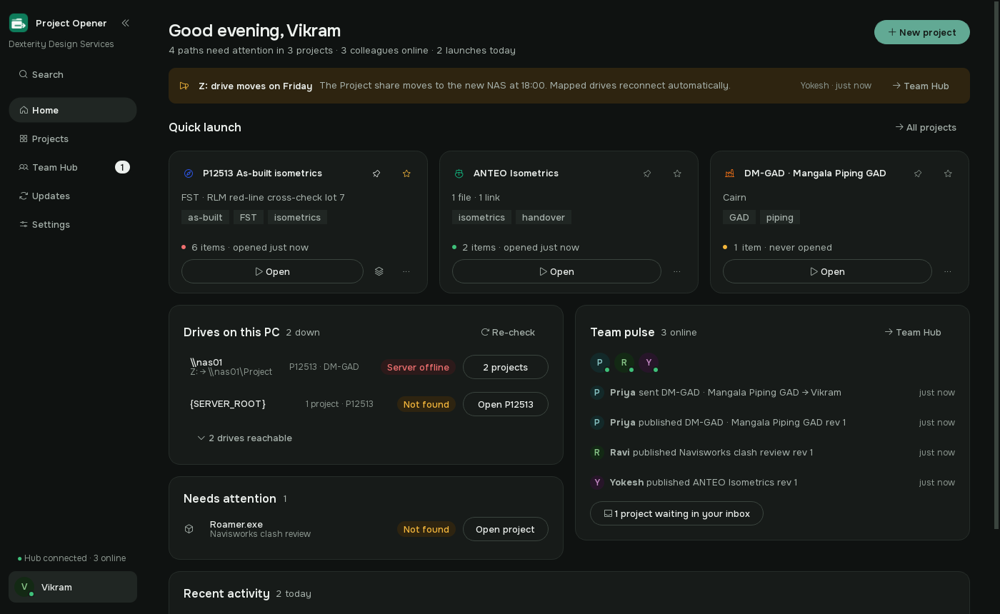
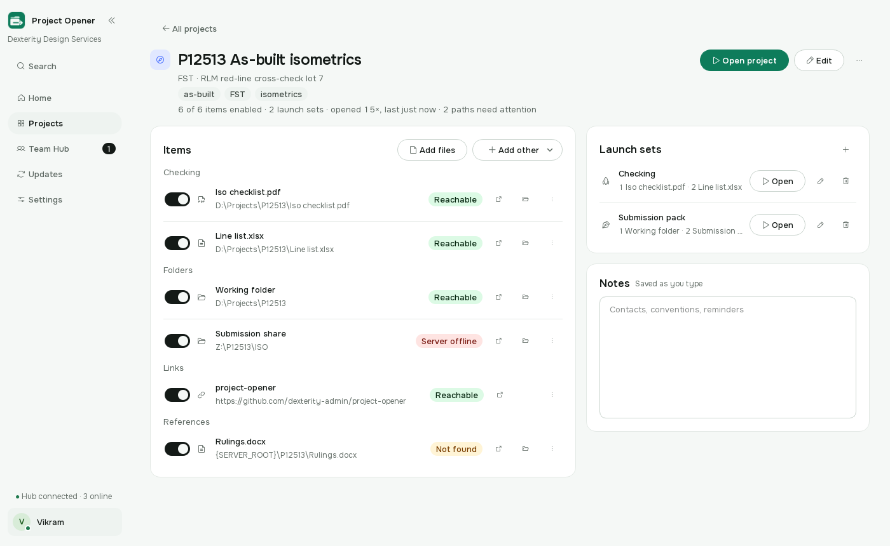
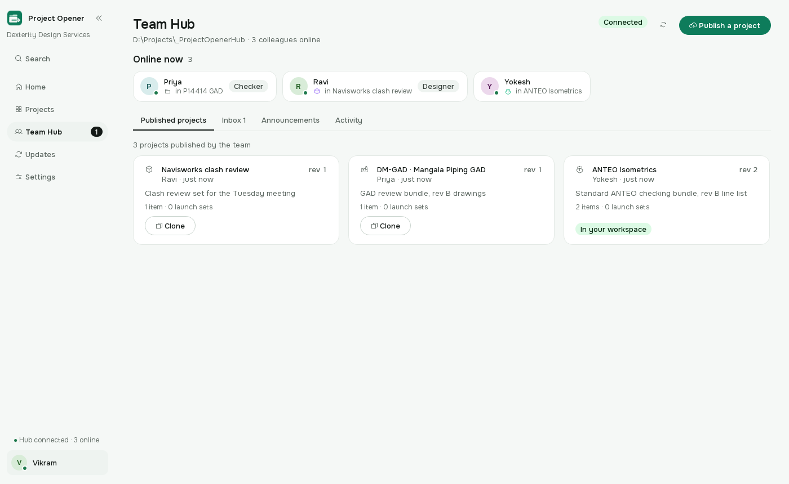

<div align="center">


# Project Opener 3

**Your whole project. One click.**

Open every drawing, folder, link and tool a job needs, share it across the Dexterity LAN, and keep
everyone on the same files, without a server.

[](https://github.com/dexterity-admin/project-opener/actions/workflows/build.yml)
[](https://github.com/dexterity-admin/project-opener/actions/workflows/pages.yml)


**[Landing page](https://dexterity-admin.github.io/project-opener/)** ·
**[User guide (PDF)](docs/Project-Opener-User-Guide.pdf)** ·
[Download the latest release](https://github.com/dexterity-admin/project-opener/releases/latest) ·
[Docs](docs/) · [Changelog](CHANGELOG.md)

</div>

---

<table>
<tr>
<td width="50%"></td>
<td width="50%"></td>
</tr>
<tr>
<td></td>
<td></td>
</tr>
</table>

> Screenshots are generated by `tools/smoke_ui.py` with demo data (CI regenerates them on every run as an artifact).

## For users

- **Landing page:** https://dexterity-admin.github.io/project-opener/ (what it does, live demo, download).
- **User guide:** [docs/Project-Opener-User-Guide.pdf](docs/Project-Opener-User-Guide.pdf), every screen, button
  and setting with real captures. Built from [docs/guide/guide.html](docs/guide/guide.html) by
  `python tools/build_guide.py` (headless Chrome + PyMuPDF; the figures come from `tools/guide_figures.py`).

## Why it exists

Every job at Dexterity touches a dozen places: the isometrics on `Z:`, the submission share on
`W:`, the line list, the client portal, Navisworks, a Teams channel. Project Opener keeps all of them
as one **launch bundle**. Click once, work starts. Version 3 adds what an office actually needs: the
bundle opens on *every* PC regardless of drive letters, it tells you *before* you click which paths
are dead, and it can be shared with a colleague over the LAN in two clicks.

## What's inside

| | Feature | What it does for the team |
|---|---|---|
| 🚀 | **Launch bundles** | Files, folders, links, apps with arguments, commands. Named **launch sets** (`Checking`, `Submission pack`) open a chosen subset as numbered steps, in the order you set. Auto-launch at sign-in. |
| ⌘ | **Command palette** `Ctrl+K` | Fuzzy search across projects, launch sets, individual items and actions. Pinned and recent first. |
| 🩺 | **Path health** | Every item is checked in the background: *Reachable*, *Not found*, *Server offline* (real port-445 probe) or *Undefined variable*, shown on the item, on the card and in the launch sheet. |
| 🗺️ | **Drives on this PC** | Home groups every path problem by its root: one row per drive letter, `\server` or `{VARIABLE}` with its pill, the mapping (`Z: → \nas01\Project`) and which jobs use it. One offline server explains ten amber projects at a glance. |
| 🔢 | **The job number first** | Cards, rows, the palette, the launch sheet and hub cards read `P12513 · As-built isometrics`; launch sets are numbered steps in the order you set; the hub shows `rev 2` and *rev 2 (was rev 1)*. |
| 🧭 | **Portable paths** | `{SERVER_ROOT}`-style variables resolve per machine; drive letters are swapped for UNC paths when sharing, and UNC paths are shown as *your* drive letter. `Z:\Project` on one PC is `\\nas01\Project` on another, and it just works. |
| 👥 | **Team Hub** | Any shared folder becomes the hub: who is online and what they're working on, publish projects for the team, clone them, get told when the author publishes a new revision, send a project to a colleague's inbox, post announcements, see an activity pulse. **No server, no database.** |
| 📡 | **LAN presence** | Optional UDP beacon for online status within seconds; the hub heartbeat remains the source of truth. |
| ⬆️ | **In-app updates** | Checks the office **LAN mirror first**, then GitHub Releases (no token needed). SHA-256 verified, silent install, automatic restart. One admin clicks *Mirror to Team Hub* and the whole office updates offline. |
| 🖥️ | **Desktop-native** | System tray with quick launch, start with Windows, single instance, `projectopener://open/<project>` deep links, drag-and-drop to create projects or add items, dark title bar. |
| 📋 | **Launch sheet** | Opening a project shows one row per item with a live status pill (*Opened*, *Not found*, *Server offline*, *Undefined variable*), the counts and the elapsed time, and the project's launch sets one click away. It closes itself when everything opened and stays when something did not. |
| 🎨 | **A designed UI** | One typeface (Onest), one flat accent, outline icons, pill controls, status pills you can read at a glance; dark, light or follow-Windows, ten accents, two densities. The rules live in [docs/DESIGN.md](docs/DESIGN.md). |
| 🛡️ | **Crash-safe data** | Atomic writes, 30 rotating backups, one-click restore, export/import. Automatic migration from Project Opener 1.x and import of 2.x hub files. |

## Install

1. Download `ProjectOpener-Setup-X.Y.Z.exe` from the [latest release](https://github.com/dexterity-admin/project-opener/releases/latest)
   **or** from the office hub folder `…\_ProjectOpenerHub\updates\`.
2. Run it. It installs per-user into `%LOCALAPPDATA%\Programs\Project Opener` (no admin rights needed).
3. First start imports your Project Opener 1.x projects automatically.
4. *Settings → Team Hub* → pick the shared hub folder → **Connect**.

A portable zip is attached to every release as well.

## Keyboard

| Keys | Action |
|---|---|
| `Ctrl+K` / `Ctrl+P` | Command palette |
| `Ctrl+N` | New project |
| `Ctrl+F` | Filter projects |
| `Ctrl+1` `Ctrl+2` `Ctrl+3` `Ctrl+,` | Home · Projects · Team Hub · Settings |
| `Ctrl+B` | Collapse sidebar |
| `F5` | Re-check all paths |
| `Alt+←` | Back |
| Double-click a card | Open the project |

## How the Team Hub works

```
      PC-A (vikram)                  \\server\Project\_ProjectOpenerHub               PC-B (yokesh)
  ┌──────────────────┐             ┌──────────────────────────────────┐          ┌──────────────────┐
  │ heartbeat 60 s ──┼──────────►  │ users/vikram.json                │  ◄───────┼── heartbeat      │
  │ publish ─────────┼──────────►  │ published/<id>.json  (rev 1,2,3) │  ───────►┼── clone / update │
  │ send to yokesh ──┼──────────►  │ inbox/yokesh/<id>.json           │  ───────►┼── accept         │
  │ announce ────────┼──────────►  │ announcements.json               │  ───────►┼── banner on Home │
  │ mirror update ───┼──────────►  │ updates/latest.json + Setup.exe  │  ───────►┼── install        │
  └──────────────────┘             └──────────────────────────────────┘          └──────────────────┘
```

Each writer owns its own files, every write is atomic, and readers tolerate corrupt files, so a
plain SMB share is all the infrastructure there is. Details in [docs/LAN-HUB.md](docs/LAN-HUB.md).

## Updates, explained

```
check ──► <hub>/updates/latest.json ──┐
      └─► GitHub Releases (token)  ───┴─► newest wins ─► download ─► SHA-256 ─► silent install ─► restart
                                                                     └─► "Mirror to Team Hub" for everyone else
```

[docs/UPDATES.md](docs/UPDATES.md) covers the manifest format, tokens and the fallback path.

## Repository map

```
project_opener/   the application (core / lan / update / ui layers)      → docs/ARCHITECTURE.md
tests/            pytest suite for core, hub and updater (no display needed)
tools/            build_icon.py · build.ps1 · smoke_ui.py · guide_figures.py · build_guide.py · make_manifest.py · version_info.py
installer/        Inno Setup script (per-user, deep links, start-up task)
site/             GitHub Pages landing page (static HTML/CSS/JS, self-hosted fonts), deployed by pages.yml
docs/             ARCHITECTURE · DATA-FORMAT · LAN-HUB · UPDATES · DEVELOPMENT · RELEASING
legacy/           Project Opener 1.x and 2.x sources, kept for reference
.github/          build.yml (installer on every push, auto-release on version bump) · pages.yml
```

## Build from source

```powershell
python -m venv .venv; .\.venv\Scripts\Activate.ps1
pip install -r requirements-dev.txt
python run.py                 # run
python -m pytest              # test
.\tools\build.ps1             # installer + portable zip into dist\
```

See [docs/DEVELOPMENT.md](docs/DEVELOPMENT.md) and [docs/RELEASING.md](docs/RELEASING.md).

## Releasing

Bump `__version__` in `project_opener/__init__.py` (and `pyproject.toml`), add a CHANGELOG section,
push to `main`. CI builds, tests, packages and publishes the release with `latest.json` and
`SHA256SUMS`. Every other push still produces downloadable installer artifacts.

---

<div align="center">
<sub>Dexterity Design Services Pvt. Ltd. · internal tool · built in-house with Python, Qt and a shared folder.</sub>
</div>


